## Linux learning progress

```text
████████████░░░░░░░░░░░░  50% complete
```

**6 / 12 phases complete · 6 remaining**  
Remaining: **6 in progress / milestone open · 0 upcoming**.

*Based on completed `[x]` phases in the learning path, equally weighted—not time remaining or total Linux mastery.*

Status key: `[ ]` upcoming, `[>]` current, `[x]` milestone demonstrated.

## Your path at a glance

> **You are here → 12 · Portfolio capstone**  
> Next: continue `sysprobe` on the VM (`~/Documents/sysprobe`), 11/11 tests passing. Network section (`ip`, `ss`) → timestamped report → README and case study → homelab run. Open milestones 6, 8, 9, 10 and 11 close when the matching capstone part is performed independently.

```mermaid
%%{init: {"theme": "base", "fontFamily": "Helvetica, Arial, sans-serif", "flowchart": {"curve": "linear", "nodeSpacing": 16, "rankSpacing": 10, "padding": 8, "htmlLabels": true, "wrappingWidth": 420}, "themeVariables": {"fontSize": "13px", "lineColor": "#d4d4d8", "titleColor": "#a1a1aa"}}}%%
flowchart TB
    subgraph A["01—03  /  BUILD YOUR FOUNDATIONS"]
        direction TB
        P1("<b>01 · Navigation</b><br/>Paths & filesystem<br/>✓ Complete")
        P2("<b>02 · File operations</b><br/>Organize safely<br/>✓ Complete")
        P3("<b>03 · Links & archives</b><br/>Connect & package files<br/>✓ Complete")
    end

    subgraph B["04—06  /  WORK WITH CONTENT"]
        direction TB
        P4("<b>04 · Inspect & edit</b><br/>Files & documentation<br/>✓ Complete")
        P5("<b>05 · Shell mechanics</b><br/>Pipes & redirection<br/>✓ Complete")
        P6("<b>06 · Text processing</b><br/>Search & build reports<br/>◐ Milestone open")
    end

    subgraph C["07—09  /  UNDERSTAND THE SYSTEM"]
        direction TB
        P7("<b>07 · Linux & access</b><br/>Layout & permissions<br/>✓ Complete")
        P8("<b>08 · Packages</b><br/>Manage software<br/>◐ Milestone open")
        P9("<b>09 · Processes</b><br/>Jobs & resources<br/>◐ Milestone open")
    end

    subgraph D["10—12  /  INVESTIGATE → AUTOMATE → BUILD"]
        direction TB
        P10("<b>10 · Services & networks</b><br/>Logs · cron · SSH<br/>◐ Milestone open")
        P11("<b>11 · Bash scripting</b><br/>Automate your checks<br/>◐ Milestone open")
        P12("<b>12 · Portfolio toolkit</b><br/>Operations & log analysis<br/>▶ YOU ARE HERE")
    end

    P1 --> P2 --> P3
    P4 --> P5 --> P6
    P7 --> P8 --> P9
    P10 --> P11 --> P12
    A --> B --> C --> D

    classDef done fill:#ffffff,stroke:#86efac,color:#3f3f46,stroke-width:1px;
    classDef review fill:#ffffff,stroke:#fcd34d,color:#3f3f46,stroke-width:1px;
    classDef current fill:#18181b,stroke:#18181b,color:#ffffff,stroke-width:1px;
    classDef future fill:#ffffff,stroke:#e4e4e7,color:#a1a1aa,stroke-width:1px,stroke-dasharray:4 4;

    class P1,P2,P3,P4,P5,P7 done;
    class P6,P8,P9,P10,P11 review;
    class P12 current;

    linkStyle default stroke:#d4d4d8,stroke-width:1px;

    style A fill:none,stroke:#f4f4f5,color:#a1a1aa
    style B fill:none,stroke:#f4f4f5,color:#a1a1aa
    style C fill:none,stroke:#f4f4f5,color:#a1a1aa
    style D fill:none,stroke:#f4f4f5,color:#a1a1aa
```



**Read left → right within each row, then down.**  
**Green:** complete for progression · **Amber:** independent milestone open · **Blue:** current focus · **Gray:** upcoming.  
Completed phases can still need review; the arrows show learning order, not a requirement to master every earlier skill before advancing.

## Coverage standard

This path targets confident, independent Linux terminal use. Its breadth is
checked against the Linux Foundation Introduction to Linux (LFS101) beginner
outline, while lessons emphasize hands-on performance rather than topic exposure.

## Dependency shape

```text
files and navigation (1-3)
          |
          v
shell data flow and text work (4-5)
          |
          v
Linux environment and access (6-7)
          |
          v
software, processes, services, and networking (8-10)
          |
          v
Bash automation and integrated terminal work (11-12)
```

## Learning path

1. `[x]` **Filesystem orientation and navigation**
   - Terminal command anatomy; working directory; absolute and relative paths
   - `pwd`, `ls`, `cd`, `.`, `..`, and `~`
   - `mkdir` and a small project directory structure
   - Milestone: navigate and construct a requested directory tree independently

2. `[x]` **Safe file organization**
   - `touch`, `cp`, `mv`, `rm`, and `rmdir`
   - Safe overwrite and removal checks; recursive operations
   - Globbing and selecting several files without unintended matches
   - Milestone: reorganize mixed files safely without procedural hints

3. `[x]` **Links, file types, and archives**
   - Regular files, directories, and other common file types
   - Hard links and symbolic links; copying versus linking
   - `tar`, `gzip`, `bzip2`, and `xz`; inspect before extracting
   - Milestone: package, verify, extract, and restore a disposable project
   - Completed 2026-11-01 with an independently planned bzip2 archive workflow;
     case-sensitive compression-option recall was retained on 2026-11-02

4. `[x]` **Content inspection, CLI editing, and documentation**
   - `cat`, `less`, `head`, `tail`, `nl`, and `file`
   - Follow changing output and choose tools appropriate to file size and purpose
   - Create and edit text with a terminal editor; save, search, and exit safely
   - `--help`, shell `help`, `man`, `info`, and installed documentation
   - Milestone: inspect an unfamiliar file or log and use local documentation to
     complete an unfamiliar editing or command task
   - Completed for curriculum progression on 2026-11-03; unfamiliar-option
     recovery and evidence quality remain active review items

5. `[x]` **Shell mechanics, pipes, and redirection**
   - Quoting, escaping, expansion, variables, environment, history, and aliases
   - Standard input, output, and error; `>`, `>>`, `<`, `2>`, pipes, and `tee`
   - Exit status, `&&`, `||`, and safe command sequencing
   - Milestone: predict and verify where each command's input, output, and error
     travel through a multi-stage command
   - Introductory work began 2026-11-03 with `>`, `>>`, `<`, `2>`, and `|`;
     completed for curriculum progression on 2026-11-08 after spaced retrieval;
     combined routing and variable integration retain GUIDED review items

6. `[>]` **Text searching and manipulation**
   - `grep` and basic regular expressions
   - `wc`, `cut`, `paste`, `sort`, `uniq`, `tr`, `diff`, and `join`
   - `xargs`, introductory `sed`, and introductory `awk`
   - Milestone: derive and verify a requested report from unfamiliar text data
   - Work began 2026-11-08 with `grep`, anchors, `.*`, `sort`, `uniq`, `cut`,
     and `tr`; introductory practice now covers every listed tool. A second
     unfamiliar normalized report was completed and verified with focused
     guidance; independent milestone performance remains to be tested

7. `[x]` **Linux environment, filesystem layout, and access**
   - Use a disposable Linux VM and distinguish Linux from macOS observations
   - Distributions, release information, shell versus kernel, and command paths
   - `/etc`, `/var`, `/tmp`, `/run`, `/dev`, `/proc`, `/sys`, and home directories
   - `find`, `locate`, `type`, `command -v`, `which`, and `whereis`
   - Users and groups as identities; ownership, `rwx`, `chmod`, `chown`, `chgrp`,
     `umask`, and basic `sudo` usage
   - Milestone: orient in an unfamiliar Linux host, locate requested resources,
     and repair a standard permission problem safely
   - Completed for curriculum progression 2026-11-11 with independent combined
     ownership/mode repair; umask and runtime-record reasoning remain in review

8. `[>]` **Packages and installed software**
   - Package, repository, dependency, and update concepts
   - Basic Debian-family (`apt`, `dpkg`) and Red Hat-family (`dnf`, `rpm`) usage
   - Search, inspect, install, update, and remove a test package; verify the result
   - Milestone: use documentation to manage unfamiliar test software safely
   - Guided lifecycle work completed 2026-11-12: indexed-search comparison,
     repository repair, catalog refresh, scoped upgrade, removal, and purge.
     Resumed tree plan/install completed with guidance; independent inspection
     and simulation choices succeeded, but approval reasoning needed teaching.
     Red Hat-family roles introduced conceptually; independent milestone open

9. `[>]` **Processes, jobs, and resource monitoring**
   - PID/PPID, foreground and background jobs, sessions, and signals
   - `ps`, `pgrep`, `jobs`, `bg`, `fg`, `top`, `free`, `uptime`, `df`, and `du`
   - Safe TERM -> wait -> inspect -> conditional KILL -> verify workflow
   - Milestone: investigate and control a disposable process from evidence
   - Began 2026-11-12: guided foreground/background timers, jobs, PID/PPID,
     process-state inspection, and normal completion. Guided job-control lab and
     independent targeted TERM/exit verification completed. Resource tools
     introduced; resource triage attempted and guided pgrep discovery completed.
     On 2026-11-13, completed top memory inspection, guided cleanup/TERM-ignore
     experiments with verified exits, and independent complete process inspection,
     parent verification, fresh target check, TERM, and exit verification.
     State/CPU-time and RAM interpretation remain guided; independent conditional
     escalation untested. Next: brief state/CPU retrieval, then resource interpretation

10. `[>]` **Services, logs, scheduling, and basic networking**
    - Basic `systemctl` service status/start/stop/restart behavior
    - `journalctl`, common log locations, filtering, and following new entries
    - Introductory `cron` and one safe recurring task
    - Interfaces, addresses, DNS, ports, and basic TCP/UDP concepts
    - `ip`, `ss`, `ping`, `dig` or `getent`, `curl`, and `nc`
    - SSH client usage and secure file transfer with `scp` or `sftp`
    - Milestone: answer a service or connectivity question using process, log,
      and network evidence rather than guessworkwc

11. `[>]` **Bash scripting fundamentals**
    - Script files, shebangs, execution, arguments, and command substitution
    - Tests, conditionals, loops, functions, input, output, and exit codes
    - Quoting and validation that prevent common scripting mistakes
    - Milestone: write and troubleshoot a small script that safely automates a
      repeated terminal task

12. `[>]` **Portfolio capstone — Linux operations and log-analysis toolkit**
    - Build a safe Bash command-line tool that inspects a Linux host and analyzes
      supplied sample logs without making destructive system changes
    - Produce a timestamped report containing selected system, disk, process,
      service, log, and basic network evidence
    - Use deliberate directory organization, standard permissions, pipes,
      redirection, text-processing tools, functions, arguments, exit codes, and
      dependency checks
    - Include realistic test fixtures and ordinary failures such as a missing
      file, unavailable command, stopped test service, or malformed input
    - Diagnose and repair the injected problems without procedural hints, then
      record what evidence identified each cause
    - Deliver a portfolio package containing:
      - the original script or scripts;
      - sanitized sample input and generated output;
      - a README with the problem, features, setup, usage, safety boundaries,
        design decisions, and limitations;
      - a test and verification checklist;
      - a concise troubleshooting case study;
      - a reproducible demonstration on a disposable Linux VM
    - Optionally publish the finished package in a Git repository; Git operation
      is a publishing step, not an additional curriculum phase
    - Milestone: independently demonstrate the project from a clean setup,
      explain the implementation, verify its output, and meet the performance
      criteria in `GOAL.md`

## Current position

Phases 1 and 2 are complete: filesystem navigation/construction and the
integrated safe-file-organization checkpoint have been demonstrated.

Phase 3 is complete. Symbolic-link, hard-link, and relative-link experiments
were completed with guidance, and the learner independently planned and
executed a safe bzip2 package/list/extract workflow. The case-sensitive
compression mapping was retrieved correctly after spacing on 2026-11-02. Link
reasoning and complete archive-evidence capture remain review items.

Phase 4 is complete for curriculum progression. Content classification, bounded
and interactive inspection, live log following, and terminal editing were
demonstrated. Unfamiliar local-documentation recovery and evidence quality stay
in `REVIEW.md` rather than blocking forward progress.

Phase 5 is complete for curriculum progression as of 2026-11-08. After the
November 7 rebuild, a spaced session independently retrieved redirection order,
conditional sequencing, environment export, alias inspection, and history
meaning. A short portable `tail | tee | wc` route was constructed and verified
after a functional `tee` cue. Immediate status capture, combined routing, and
variable/command-substitution integration remain review items rather than
blocking forward progress.

Phase 6 introductory coverage is complete; its independent report milestone
remains open for spaced review. On 2026-11-09 the learner independently recovered
the `join` delimiter option and reconstructed report processing stages. Exact
status selection required a field-boundary hint before successful verification.

Phase 7 is complete for curriculum progression as of 2026-11-11. Ubuntu host
orientation, command lookup, filesystem interfaces, find/xargs, and standard
ownership/permissions have been exercised. An independent shared-workspace
repair correctly combined distinct directory policies, group ownership, file
permissions, content preservation, and evidence auditing. Umask derivation,
runtime records versus kernel identity, PATH ordering, and find/xargs retention
remain in interleaved review.

Phase 8 is active. Guided practical coverage now includes package metadata,
installation, locate's index versus live search, a real repository failure and
repair, catalog refresh, scoped upgrade, removal, and purge. Verification was
completed for the upgrade and cleanup. The resumed tree plan/install succeeded
with guidance in metadata and approval reasoning; independent command selection
and bounded tree execution were demonstrated. Red Hat-family roles introduced
conceptually, without execution. Full independent package management remains
open, as does Phase 6's independent report milestone.

Phase 9 began with guided timers and process inspection: foreground waiting,
background jobs, PID/PPID, Bash parentage, S state, and normal completion.
Guided job-control practice and independent fresh-PID inspection, targeted TERM,
and exit verification succeeded. Parent-name evidence needed a reminder.
Resource monitoring now includes uptime/nproc/top, free, df, and du; home-directory
usage construction succeeded independently, while resource interpretation remains
guided. On 2026-11-13, top memory inspection and privileged/unprivileged du
comparison were completed; incomplete-total recognition was correct. Guided
TERM cleanup and TERM-ignoring/KILL experiments verified exits. A later integrated
checkpoint independently completed job/process/parent inspection, fresh target
verification, TERM, and exit checks. Process-state interpretation remains a
significant gap: sleeping was repeatedly interpreted as CPU polling despite
elapsed/CPU timing evidence. Contrasting busy-loop evidence was taught, not
independently interpreted. RAM available-versus-free selection also needed
correction. On 2026-11-14, sleep timing and available RAM were correctly
recognized after spacing; shared-memory accounting still needed correction.
Known-fixture TERM/KILL selection was independent, but waiting, justification,
and complete verification remained guided. Full Phase 9 milestone remains open;
interleave later review rather than repeat completed worksheets.

### Phase 10 entry — 2026-11-14

Read-only cron and dbus investigations completed. Full status and current-boot
bounded journal queries independently constructed for dbus; definition retrieval,
static enablement, and log-evidence interpretation remained guided. Subsequently
completed guided disposable user-service creation/restart/stop/collection after
scope and name checks; independently constructed its user-journal history query.
No persistent service configuration changed; lab service cleanup verified.
Service control remains guided. Completed guided personal cron installation,
repeated timestamp observation, and verified removal/restoration to no crontab.
Networking was subsequently introduced in the continuation below.
Phase 9 interpretation/escalation review remains open; no repeat of completed labs.

### Phase 10 networking continuation — 2026-11-14

Guided interface/address, routing, ICMP, name-resolution, HTTPS, and TCP-listener
inspection completed with actual Ubuntu output. Linked SSH listener/process/socket
unit/service evidence. Configured localhost-only VirtualBox NAT forwarding as
reported, completed Mac-to-Ubuntu SSH login, and uploaded a file with matching
local/remote SHA-256 evidence. Host/guest loopback, forwarded port selection,
reachability versus listening/authentication, and verification remain guided.
No independent connectivity milestone yet; UDP practical coverage remains open.

### Networking checkpoint and Bash entry — 2026-11-15

Download completed after an operand-order hint; two-sided hash commands independently
constructed. TCP/UDP socket inspection and a loopback UDP experiment completed with
guidance and receiver exit verified. Web and integrated diagnostic worksheets showed
independent tool selection and bounded curl construction, but hostname/URL,
resolver/result, endpoint binding, and evidence-scope reasoning still needed teaching.
Introductory networking coverage complete; independent Phase 10 milestone remains open.
Interleave later review rather than repeat the completed labs.

Phase 11 begins with correct recognition that an intervening successful command
replaces an earlier failure in $?. Practical immediate status capture remains to be
demonstrated. First script worksheet prepared: labs/2026-11-15-first-bash-script.md.
Verified wholly unattempted at November 15 session closure; no script written or run.
Next: write and run a bounded web-check script via explicit Bash invocation, capture
its status, then introduce arguments and conditional behavior as understanding permits.

### Bash practical checkpoint — 2026-11-16

Completed guided scripting work: direct invocation/shebang/permissions, quoted
arguments, command substitution and variables, if/else, argument loops, and
remembering failures across iterations. Built a multi-URL checker with verified
0/1/2 outcomes. Immediate status-capture commands and loop/conditional composition
show independent elements; full script construction and verification remain guided.

Next: `labs/2026-11-16-file-checkpoint.md`, verified wholly unattempted at closure.
Assess independent combination before adding functions or other scripting features.
Phase 11 remains current; its independent milestone is not yet complete.

### Functions and line-input checkpoint — 2026-11-17

Local-file checker completed with independent loop/flag construction and guided
validation/verification. Function refactoring and line-input integration completed
with guidance; inverted readability guard repaired and tested. Phase 11's full
independent milestone remains open; phase completion remains 6/12 (50%).

Next: `labs/2026-11-17-list-checkpoint.md`. Fixture directory recorded at closure,
but script and all five tests remain TODO. Recheck fixture availability, then
assess reduced-scaffolding integration before adding syntax. Do not repeat the
completed local-file, function, or fixed-list labs.

### Parameterized list checkpoint — 2026-11-21

The list checker is functionally complete, with all five spec tests passing. It was GUIDED: the task model and the combined list guard needed teaching. The line loop, function, and flag were constructed independently. The Phase 11 milestone remains open, and phase completion is unchanged at 6/12 (50%).

### Capstone entry — 2026-11-21 (continuation)

The learner chose to advance to Phase 12 rather than continue Phase 11 drills.
The open milestones (6, 8, 9, 10, 11) were deliberately not marked complete;
each closes when its matching capstone part is performed independently (mapping
in `labs/2026-11-21-capstone-kickoff.md`). Started with a design-first spec and a
predicted test plan before any code. Targets: build and failure tests on the
disposable Ubuntu VM; real read-only run on the learner's Ubuntu homelab laptop
(Docker, Tailscale) after the tests pass. Homelab output is sanitized before publishing.

### Capstone build begins — 2026-11-22

Switched from a paper-only spec to building with design questions inline.

Built so far:
- the project tree, an input guard and an ERROR-count section;
- `tests/run-tests.sh` with 4 automated cases, mutation-tested.

The kickoff worksheet remains the design reference. Its open items are the service argument, stop-versus-continue, §3 commands and §7 rows E/G. No milestones were closed; completion is unchanged at 6/12.

Same-day continuation: added the failed-logins section, a mixed-auth fixture, and a 5th test that checks output, proven by a mutation test. Next is the system section. Completion is unchanged at 6/12.

### System section — 2026-11-23

The System section (Host, Load, Disk /) is built. Test 6 works out its expected value at run time and is proven by a mutation test. The design now splits dependencies into required (`grep awk sort uniq`, which stop the run) and optional (which print "unavailable"). The dependency check is next. No milestones closed; completion is unchanged at 6/12.

### Dependency checks — 2026-11-24

Built the required-dependency check (exit 3) with test case 7 (7/7), and optional lines that print `unavailable`. At the learner's request, the pace is now project-first: the tutor supplies routine code, and milestones still close only on independent work. Remaining: memory, processes, service/journal, network, report file, README/case study, homelab run. Completion is unchanged at 6/12.

### Memory and top processes — 2026-11-25

Built the Memory and Top processes lines, each with its own optional guard, and fixed an unsilenced Load guard. Tests are 9/9, both new cases mutation-proven. Remaining: service/journal, network, report file, README/case study, homelab run. Completion is unchanged at 6/12.

### Service and journal — 2026-11-26

Built the Service section. The service is an optional 2nd argument; `systemctl` status 4 prints `not found`; the journal runs only for existing units. Fixed two test-runner flag bugs. Tests are 11/11, with both new cases mutation-proven. Remaining: network, report file, README/case study, homelab run. Completion is unchanged at 6/12.

## Current scope boundary

This roadmap intentionally stops at terminal-user confidence. Advanced identity
administration, persistent network/firewall configuration, disk partitioning and
LVM, boot/kernel recovery, SELinux/AppArmor administration, service deployment,
Git workflows, containers, and virtualization management are deferred.
