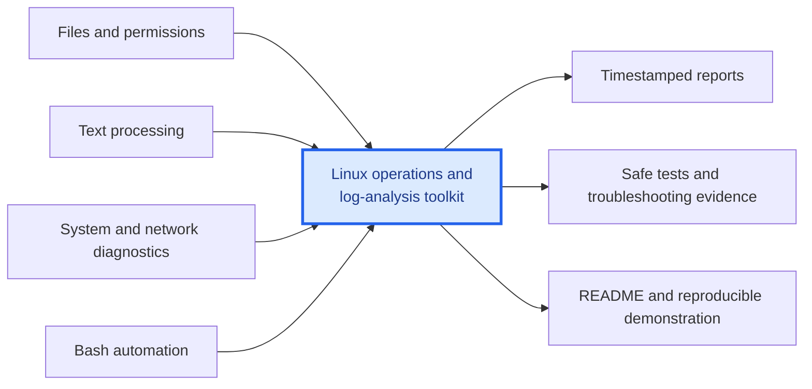

# Linux learning roadmap — visual overview

Snapshot: **2026-11-15** · Source: [[../ROADMAP|ROADMAP]]

> **You are here: Phase 11 — Bash scripting.**
> Your first script is prepared but not yet attempted. Earlier open milestones remain in review while you move forward.

## The learning path

**Green:** completed for progression · **Amber:** independent milestone still open · **Blue:** current focus · **Gray:** upcoming

Arrows show the roadmap's learning order, **not a requirement to perfect every earlier skill before advancing**. Completed phases can still have review items.

```mermaid
flowchart TB
    subgraph foundations["FOUNDATIONS · Files and shell"]
        direction TB
        P1["1 · Filesystem orientation and navigation<br/>Paths · pwd · ls · cd<br/>COMPLETE"]
        P2["2 · Safe file organization<br/>Copy · move · remove · globbing<br/>COMPLETE"]
        P3["3 · Links, file types, and archives<br/>Links · tar · compression<br/>COMPLETE"]
        P4["4 · Content inspection, editing, and documentation<br/>View files · edit text · use manuals<br/>COMPLETE FOR PROGRESSION"]
        P5["5 · Shell mechanics, pipes, and redirection<br/>Streams · quoting · exit status<br/>COMPLETE FOR PROGRESSION"]
        P1 --> P2 --> P3 --> P4 --> P5
    end

    subgraph environment["DATA AND ACCESS · Work with Linux"]
        direction TB
        P6["6 · Text searching and manipulation<br/>Search · transform · build reports<br/>INDEPENDENT REPORT MILESTONE OPEN"]
        P7["7 · Linux environment, filesystem layout, and access<br/>VM · filesystem · ownership · permissions<br/>COMPLETE FOR PROGRESSION"]
        P6 --> P7
    end

    subgraph operations["OPERATIONS · Investigate and manage"]
        direction TB
        P8["8 · Packages and installed software<br/>Inspect · install · update · remove<br/>INDEPENDENT LIFECYCLE MILESTONE OPEN"]
        P9["9 · Processes, jobs, and resource monitoring<br/>Inspect · signal safely · interpret resources<br/>FULL MILESTONE OPEN"]
        P10["10 · Services, logs, scheduling, and networking<br/>systemd · cron · TCP/UDP · SSH/SCP<br/>INTRODUCTORY COVERAGE COMPLETE; MILESTONE OPEN"]
        P8 --> P9 --> P10
    end

    subgraph automation["AUTOMATION · Build independently"]
        direction TB
        P11["11 · Bash scripting fundamentals<br/>Scripts · arguments · tests · loops · functions<br/>YOU ARE HERE — FIRST SCRIPT NEXT"]
        P12["12 · Portfolio capstone<br/>Linux operations and log-analysis toolkit<br/>UPCOMING"]
        P11 --> P12
    end

    P5 --> P6
    P7 --> P8
    P10 --> P11

    classDef complete fill:#dcfce7,stroke:#15803d,color:#14532d,stroke-width:2px;
    classDef open fill:#fef3c7,stroke:#b45309,color:#78350f,stroke-width:2px;
    classDef focus fill:#dbeafe,stroke:#2563eb,color:#1e3a8a,stroke-width:4px;
    classDef upcoming fill:#f1f5f9,stroke:#64748b,color:#334155,stroke-width:2px,stroke-dasharray:5 5;

    class P1,P2,P3,P4,P5,P7 complete;
    class P6,P8,P9,P10 open;
    class P11 focus;
    class P12 upcoming;
```

## What the final project brings together

**Next practical step:** [[../labs/2026-11-15-first-bash-script|Write and run your first Bash web-check script]].

This diagram is a companion snapshot, not a replacement for the roadmap. The original roadmap's content and statuses are unchanged.
