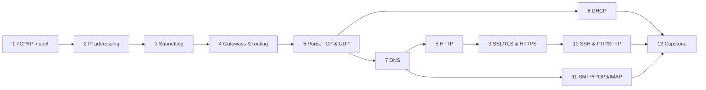

# ROADMAP — Networking & Protocols

<!-- learning-progress:start -->
```text
Phase completion  [░░░░░░░░░░░░░░░░░░░░]   0%
0/12 phases complete · 12 remaining (1 in progress, 11 upcoming)
```
<!-- learning-progress:end -->

Legend: `[x]` complete · `[>]` in progress · `[ ]` upcoming.
A phase is complete only when its mini-project is done by me and checked.

## Dependency map



## Phases

Each mini-project produces one piece of the capstone.

- [>] **1. The TCP/IP model** — what a network is, packets, layers, encapsulation.
  Mini-project: trace one web request on your Mac and label every layer used.
- [ ] **2. IP addressing** — IPv4 structure, private vs public, loopback, your
  own addresses. Mini-project: address inventory of your Mac + Ubuntu VM.
- [ ] **3. Subnetting** — masks, CIDR, network/broadcast, host counts, splitting
  a network. Mini-project: written IP plan for the capstone network.
- [ ] **4. Gateways & routing** — default gateway, routing tables, how a packet
  leaves your network. Mini-project: read/trace routes, build a 2-subnet router.
- [ ] **5. Ports, TCP & UDP** — ports, sockets, TCP handshake/reliability, UDP
  speed. Mini-project: capture a TCP handshake and a UDP datagram with tcpdump.
- [ ] **6. DHCP** — DORA, leases, what DHCP hands out. Mini-project: run a DHCP
  server and watch a client get an address.
- [ ] **7. DNS** — resolution chain, record types, caching/TTL. Mini-project:
  run an internal DNS zone with A, CNAME, MX records.
- [ ] **8. HTTP** — requests, responses, methods, status codes, headers.
  Mini-project: serve a site and talk to it by hand with curl and nc.
- [ ] **9. SSL/TLS & HTTPS** — encryption, certificates, CAs, TLS handshake.
  Mini-project: own CA, HTTPS site, HTTP→HTTPS redirect, inspect with openssl.
- [ ] **10. SSH & FTP/SFTP** — keys, host verification, tunnels/jump hosts;
  FTP (cleartext) vs SFTP. Mini-project: key-only SSH + locked-down SFTP drop
  box; capture FTP password in cleartext to prove why SFTP matters.
- [ ] **11. SMTP / POP3 / IMAP** — sending vs retrieving mail, MX records.
  Mini-project: send mail via SMTP, read it via IMAP and POP3.
- [ ] **12. Capstone — "Office-in-a-Box"** (see below).

## Capstone — Office-in-a-Box (portfolio project)

A small company network built from scratch on Linux, reproducible and documented.

| Piece | Topics proven |
|---|---|
| IP plan with two subnets (clients, servers) | IP addressing, subnetting |
| Linux router between subnets as default gateway | gateways, routing, TCP/IP |
| DHCP server for the client subnet | DHCP, UDP |
| Internal DNS for `corp.lab` (A, CNAME, MX) | DNS, UDP |
| Web app over HTTPS from own CA, HTTP redirects | HTTP/HTTPS, SSL/TLS, ports |
| Key-only SSH bastion + SFTP drop box (FTP contrast) | SSH, FTP/SFTP |
| Mail server: SMTP send, IMAP/POP3 read | SMTP/POP3/IMAP |

Deliverables (GitHub repo): architecture diagram, IP/subnet table, port matrix,
rebuild script, `netcheck.sh` that tests every service layer-by-layer, packet
captures as evidence, and a troubleshooting runbook with 3 documented
break-and-fix incidents. Lab platform (VMs vs lightweight Linux isolation)
chosen at Phase 12 kickoff based on what runs well on this machine.

## Current position

Phase 1 — in progress. Concepts taught 2026-11-18; mini-project worksheet
`labs/2026-11-18-phase1-trace-a-web-request.md` not yet attempted.
